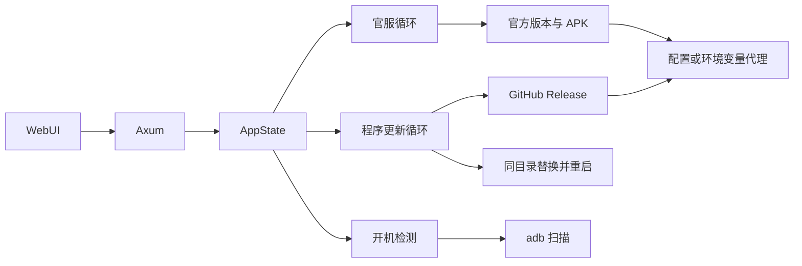

# 技术方案

## 架构

仍是单进程。在原来的官服无人值守循环旁边加两条循环：

- 程序更新循环：启动约 3 秒后查 GitHub Release，之后按 `app_update_interval`（默认 `6h`，最短按 5 分钟）。
- 开机检测循环：启动约 5 秒后做第一轮，比官服循环的 8 秒更早，但第一轮只扫描；真正安装要等设备在线且版本落后。之后按 `emulator_watch_interval`（默认 `1m`，最短 15 秒）。

官服那一轮保持原样：落后的离线模拟器仍可能被拉起。开机检测只调用现有的设备扫描，不调用启动命令。

发布构建在编译时写入 `ARK_UPDATER_GIT_SHA`。Release 工作流把 `github.sha` 放进这个环境变量。本地 `cargo run` 没有该变量，视为开发构建。

## 技术栈

沿用现有 Rust、axum、reqwest + rustls。reqwest 增加 `socks`，用来支持 `socks5` 和 `socks5h`。新增 `sha2`、`flate2`、`tar`、`zip`，只为校验和解出程序自己的压缩包，不引入自更新框架。

默认更新源是 `https://api.github.com/repos/ModerRAS/arknights-auto-update/releases/latest`。`app_update_feed` 可改成另一份相同 JSON，便于测试；只允许 `https`，或本机回环上的 `http`。

## 程序更新怎么判定

Release 的 `tag_name` 必须是 `vMAJOR.MINOR.PATCH`。资产名沿用上传动作的格式：`ark-updater-<tag>-<target>.tar.gz` 或 `.zip`，旁边有同名 `.sha256`。

| 本机 | 远端 | 结果 |
| --- | --- | --- |
| 版本更低 | 任意已识别提交号 | 更新 |
| 版本相同，双方提交号不同 | 发布构建 | 更新 |
| 版本相同，提交号相同或远端没有提交号 | 任意 | 不更新 |
| 没有提交号 | 版本不更高 | 不更新 |
| 版本更高 | 任意 | 不降级 |

目标三元组按当前系统选择，Linux 使用发布里的 musl 包。压缩包只解出名为 `ark-updater` 或 `ark-updater.exe` 的文件，拒绝 `..` 和绝对路径，并核对 ELF、PE 或 Mach-O 魔数。解出的文件先放到可执行文件同目录的 `*.new`，再由当前程序的第二个进程等待原进程退出后改名。Windows 上先把正在运行的文件改名为 `*.old`。替换进程继承忽略 `SIGHUP`，避免原控制台关掉时把新进程一起带走。

Cargo `target/debug` 与 `target/release` 下的程序只提示、不自动替换。页面上的「更新并重启」仍会替换。

官服更新进行时不下载程序包、也不重启。`update_busy` 同时看官服任务和程序更新的下载、校验、替换阶段。开始官服安装前用一把锁避免和开机检测互相取消。

## 代理

`proxy` 的取值：

| 配置 | 行为 |
| --- | --- |
| 空 | `ALL_PROXY`、`all_proxy`、`HTTPS_PROXY`、`https_proxy`、`HTTP_PROXY`、`http_proxy` 里第一个非空值 |
| `off` | 直连，忽略环境变量 |
| `http` / `https` / `socks5` / `socks5h` URL | 使用该代理 |

官方版本查询、APK 下载、程序更新查询和程序包下载共用这一选择。保存配置或配置文件变更后重建 reqwest 客户端。回环地址不走代理，这样本机测试源和 APK 直链覆盖仍直接访问。页面上的代理字符串会去掉用户名和密码。

程序包下载自己跟随重定向，默认源只允许 `github.com`、`*.github.com`、`*.githubusercontent.com` 的 `https`。自定义源只允许回到该源的主机，或回环地址。

## 开机检测

每一轮调用现有 `refresh_devices`。在线且版本落后、并且 10 分钟内没有尝试过的设备，用「只更新这些序列号」开始安装；离线条目不放进这次请求，因此不会走到拉起模拟器的分支。设备再次离线时清掉冷却。自动安装关闭时只更新页面文案。adb 暂时找不到时，仍把已配置的模拟器留在设备列表里，页面继续说明正在等哪些模拟器开机。

已经有官服任务或程序包下载时，这一轮直接跳过，避免 adb 和替换进程打架。

## 接口与配置

新增配置：

| 字段 | 默认 | 含义 |
| --- | --- | --- |
| `proxy` | 空 | 空则跟随环境变量，`off` 强制直连 |
| `app_update_interval` | `6h` | 程序更新间隔，`off` 关闭 |
| `auto_apply_app_update` | `true` | 发现新构建后自动替换 |
| `app_update_feed` | 空 | 空则用 GitHub 最新 Release |
| `emulator_watch_interval` | `1m` | 开机检测间隔，`off` 关闭 |

`GET /api/state` 增加 `app_update`、`watch` 和 `proxy`。`POST /api/app-update/check` 只查询。`POST /api/app-update/apply` 查询并在有新构建时替换重启。旧 TOML 缺字段时用上面的默认值，不改写用户原来的官服自动更新开关。

隐藏参数 `--replace-from`、`--replace-to`、`--wait-for-parent`、`--restart-arg`、`--from-self-update` 只给替换进程用。`--replace-to` 必须就是当前可执行文件，`--replace-from` 必须是它旁边的 `*.new`。

## 测试策略

纯函数覆盖版本判定、资产选择、SHA256 文本、代理选择与脱敏、更新源地址、压缩包路径检查，以及开机检测选出的序列号。本地 HTTP 服务提供一份假 Release，核对会下载对应压缩包、校验 SHA256 并只解出可执行文件。一个只回答绝对 URL 请求的本地代理用来证明客户端确实走了代理。不在测试里替换正在运行的 `cargo test` 二进制。

## 安全性

监听地址仍然只允许回环。代理凭据不进页面和日志。程序包地址按来源限制主机。替换参数不能指向任意路径。压缩包里的其他文件不落盘。不降级，也不在校验失败时覆盖当前程序。
