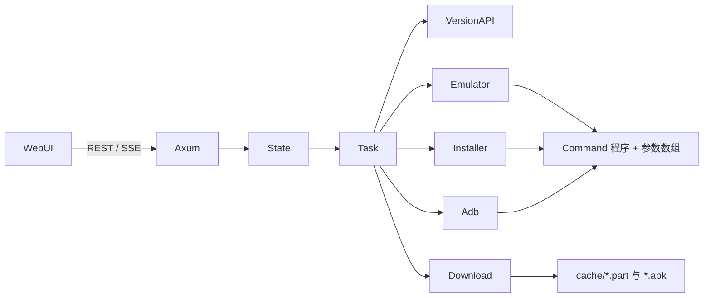

# 技术方案

## 架构

单进程 Tokio 运行时。`main` 只调用 `ark_updater::run`。启动时加载配置、初始化 tracing（控制台、按日文件、SSE）、创建 `AppState`，再由 axum 同时提供 REST、SSE 和内嵌静态文件。

长任务在 `task` 模块编排：官方版本、设备探测、一次下载、按设备并发安装。下载用 `SingleFlight` 合并同版本请求。每台设备一把 `tokio::Mutex`，安装并发用 `Semaphore`。这些锁都不在下载或安装的全程持有全局 `RwLock`。

无人值守循环在启动约 8 秒后跑第一轮，之后按 `auto_check_interval`（默认 `6h`）重复。`plan_unattended` 只把落后或未知的设备放进本轮：在线设备看刚读到的 `versionName`，离线模拟器看 `known-versions.json`。已经有任务在跑时，下一轮延后一分钟，不取消当前安装。

平台差异放在 `platform/windows.rs` 与 `platform/other.rs`：注册表、磁盘剩余空间、模拟器目录、打开浏览器。业务模块通过 `platform` 的同一组函数调用。

## 技术栈

- Rust edition 2021，`rust-version = 1.88`（由锁定依赖决定）
- axum 0.7、tower-http（压缩与 trace）。SSE 路由单独合并，不经过压缩层，避免被缓冲
- reqwest + rustls。版本查询超时 30 秒；下载连接超时 60 秒，不设置总超时
- rust-embed 托管 `web/`
- serde / toml、tracing、thiserror、clap
- Windows 注册表用 winreg；非 Windows 磁盘查询用 libc `statvfs`

## 关键数据结构

`AppConfig`：监听地址、adb、缓存目录、并发、各类超时、自动检查、直链覆盖、手动设备、`emulators`。`EmulatorConfig` 含 `id`、`name`、`kind`（`mumu` / `ldplayer` / `custom`）、`start_program`、`start_args`、`vmindex`、`expected_serial`、`adb_port`、`adb_path`、`install_dir`。

`DeviceSnapshot`：序列号、型号、Android、ABI、兼容标记、已装版本与展示文案、是否装了 B 服包、在线状态、所属模拟器、使用的 adb、`TaskView`。

`TaskPhase`：`idle` → `waiting_online` → `checking` → `downloading` → `installing` → `launching` → `succeeded` / `failed` / `cancelled`。`TaskView` 带百分比、文案和 `FailureKind`。`DownloadPhase` 单独描述全局 APK：`idle` / `resolving` / `downloading` / `verifying` / `ready` / `failed`。

更新目标选择 `DeviceSelector`：JSON 字符串 `"all"`，或序列号数组。

## 接口与持久化

REST/SSE 见 README。配置写入 TOML。程序目录已有 `config.toml` 时优先使用，否则写入系统配置目录。APK 缓存默认不跟可执行文件放在一起，避免写到 `Program Files`。

## 安装与下载策略

直链解析：跟随重定向；最终 URL 以 `.apk` 结尾或内容类型为安装包则采用，否则正则提取。备用源取第一行 `.apk`。下载流式写盘，不把包读进内存。校验大小与 `PK` 头。

安装顺序：模拟器原生 CLI（MuMu 三种参数形态，或雷电 `installapp`）→ `adb install -r` → `adb install --no-streaming -r`。`force` 追加 `-d`。超时默认 1800 秒。

## 测试策略

纯函数单测覆盖版本分段比较、官方 JSON、文件名版本、ABI、`df`、设备列表、安装失败分类、Content-Range、间隔语法、回环地址、TOML 往返、命令参数。Unix 集成测试用假 adb 脚本和本地 axum 文件服务验证：x86 不产生下载；两台设备只产生一次 HTTP GET，并各自留下安装记录。

CI：ubuntu 上 `fmt --check`、`clippy -D warnings`、`test`；`windows-latest` 上 `clippy -D warnings` 与 `test`，以编译注册表与 `CREATE_NO_WINDOW` 路径。

## 安全性

只绑定回环地址。不收集账号，不自动卸载。外部程序参数单独传递。路径无效的显式 adb 不会被静默替换，除非用户在检测接口里明确要求回退。
