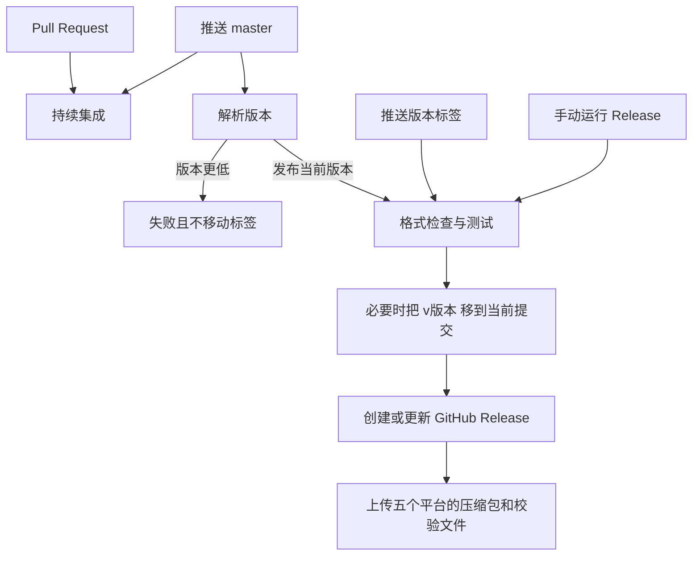

# 技术方案

## 架构

仓库用 GitHub Actions 做检查和发布。版本决策集中在 `scripts/resolve-release.sh`，工作流和测试调用同一份逻辑。

持续集成定义在 `.github/workflows/ci.yml`，具体命令在 `.github/actions/rust-ci`。Release 工作流在决定发布之后调用同一个动作，避免两套检查漂移。创建 Release 和上传产物的任务显式要求前一个任务成功；带 `if` 的任务不会在依赖失败或跳过时继续执行。

## 技术栈

- 程序是 `ark-updater`（edition 2021，`rust-version` 1.88）。CI 使用 Rust stable。`rust-toolchain.toml` 把本地渠道固定为 stable。
- GitHub Actions：`actions/checkout@v7`、`dtolnay/rust-toolchain@stable`、`Swatinem/rust-cache@v2`、`softprops/action-gh-release@v3`、`taiki-e/upload-rust-binary-action@v1`。
- Dependabot 每周检查 Actions 和 Cargo 依赖更新。

`Cargo.toml` 设置 `publish = false`。发布目标是 GitHub Releases，不向 crates.io 上传。

## 版本决策

`scripts/resolve-release.sh` 只接受不含前导零的 `MAJOR.MINOR.PATCH`。

| 事件 | 条件 | 结果 |
| --- | --- | --- |
| 推送 `master` | 还没有稳定标签，或 `version` 高于最新稳定标签 | 发布 `v<version>` |
| 推送 `master` | `version` 等于最新稳定标签，且该标签指向当前提交 | 重新上传该 Release 的产物 |
| 推送 `master` | `version` 等于当前版本标签，但标签指向更早的提交 | 把 `v<version>` 移到当前提交并更新产物 |
| 推送 `master` | `version` 低于最新稳定标签 | 失败，不移动已有标签 |
| 推送标签 | 标签与 `version` 一致，且指向当前提交 | 发布该标签 |
| 推送标签 | 标签与 `version` 不一致、不是稳定版本号、指向其他提交，或 `version` 低于最新稳定标签 | 失败 |
| 手动运行 | 分支是 `master`，标签为空或等于 `v<version>`，且版本不低于最新稳定标签 | 发布；标签若指向其他提交则移动它 |
| 手动运行 | 分支不是 `master`、标签与版本不一致，或版本低于最新稳定标签 | 失败 |

同一个版本在 `master` 上的后续提交会移动标签 `v<version>`，Release 始终对应该版本的最新 `master` 提交。更高版本使用新标签，旧标签保留。新的 `master` 推送会取消尚未完成的发布；如果取消前 `master` 已经前进，这次发布会失败，避免旧提交把标签移回去。`master` 上的自动发布由同一次工作流创建或移动标签并上传产物；用默认 `GITHUB_TOKEN` 创建或强制更新的标签不会再次触发工作流。

## 发布产物

构建矩阵：

| target | 运行器 | 压缩格式 |
| --- | --- | --- |
| `x86_64-unknown-linux-musl` | `ubuntu-latest` | `.tar.gz` |
| `aarch64-unknown-linux-musl` | `ubuntu-latest` | `.tar.gz` |
| `x86_64-pc-windows-msvc` | `windows-latest` | `.zip` |
| `aarch64-apple-darwin` | `macos-latest` | `.tar.gz` |
| `x86_64-apple-darwin` | `macos-latest` | `.tar.gz` |

压缩包带前导目录，包含可执行文件、`LICENSE` 和 `README.md`。每个压缩包另有 SHA256 校验文件。Release 说明由 GitHub 根据提交自动生成，并标为最新版本。

## 权限

- CI 只有 `contents: read`。
- 创建 Release 的任务有 `contents: write` 和 `pull-requests: read`。
- 上传产物的任务有 `contents: write`。
- 令牌使用运行自带的 `GITHUB_TOKEN`，不读取额外密钥。

## 测试策略

- `cargo test` 覆盖参数解析、版本号格式，以及 `--version`、`--help` 和错误退出码。
- `scripts/resolve-release-test.sh` 覆盖决策表，并用临时 Git 仓库覆盖“选择最新标签”“第一次发布”“同版本移动标签”和“版本降低失败”。
- 本地用 shellcheck 和 actionlint 检查脚本与工作流。
- 多平台上传依赖 GitHub 托管运行器，本地不执行实际上传。

## 安全性

- 进入标签和版本比较的字符串先经正则校验，再写入工作流输出。
- 发布任务只移动当前 `Cargo.toml` 版本对应的标签。版本降低时失败，不改写更高版本的标签。直接推送的标签如果没有指向当前提交，工作流失败。
- Release 构建使用 `--locked`，并提交 `Cargo.lock`。
- CI 的 `RUSTFLAGS=-Dwarnings` 只加在检查任务上，避免上传任务在安装交叉编译工具时把警告当成错误。
